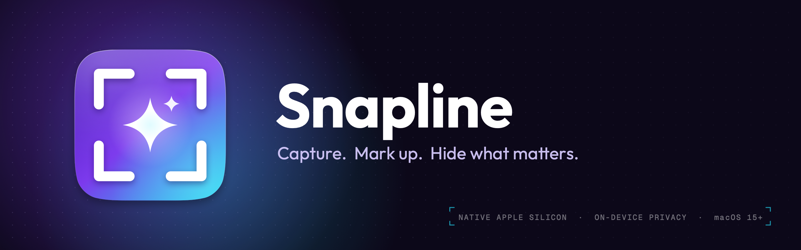

# Snapline



A native Apple Silicon screenshot tool for the macOS menu bar, modelled on Lightshot. Select an area, draw on it, then copy, save, print, edit, email, upload (S3 or Google Drive) or search for similar images. Sensitive data is hidden automatically on every capture.

- Swift 6.4, AppKit, ScreenCaptureKit, Vision. No third-party dependencies.
- Copy the text out of any screenshot, read on your Mac.
- arm64 only, macOS 15 or newer.
- Written from scratch: Snapline shares no code or artwork with Lightshot.

## Privacy

Snapline is private by design. It has no servers, no accounts of its own, no analytics and no tracking.

- **Everything runs on your Mac.** Capturing, drawing, auto-hide and Copy Text use Apple's built-in frameworks
  (ScreenCaptureKit, Vision) on this device. No screenshot and no recognised text is sent to Snapline or to any third
  party to be read, analysed or stored.
- **An image leaves your Mac only when you ask it to:**
  - **Upload** sends it to the destination you set up: your own S3 bucket or your own Google Drive.
  - **Search** uploads it there first, then opens Google Lens or TinEye in your browser with that link.
  - **Email** hands the file to your mail app.
- **Secrets stay in the macOS Keychain**: bucket keys and the Google sign-in token. Google sign-in runs in your browser;
  Snapline only receives the result on a local address (127.0.0.1).

You can check this in the code: all network calls are in `macOS/Sources/Snapline/Uploaders.swift` and `GoogleAuth.swift`.

## Build and run

The macOS app is the Swift package in `macOS/`. Run these from there:

```bash
cd macOS
swift test                     # unit tests (signing, OAuth, matchers, geometry)
scripts/make-app.sh            # builds build/Snapline.app (arm64, ad-hoc signed)
scripts/make-app.sh --install  # same, then replaces /Applications/Snapline.app and starts it
open build/Snapline.app
```

On the first capture macOS asks for **Screen Recording** permission (System Settings → Privacy & Security → Screen &
System Audio Recording). If the build is signed ad hoc (no certificate, the default), macOS treats **each rebuild as a
new app**: it asks again, and Keychain may ask once to let Snapline read its saved keys ("Always Allow"). To avoid that,
see below.

### Keep permissions across rebuilds

`macOS/scripts/make-app.sh` signs with a stable certificate when it finds one, in this order: the `SNAPLINE_SIGN_IDENTITY`
environment variable, an **Apple Development** certificate, a **Snapline Local Signing** certificate, otherwise ad hoc.
It prints which one it used. Create one of these once:

**Option A: free Apple Development certificate (recommended, needs an Apple Account)**
1. Open **Xcode → Settings → Accounts**, click **+**, and sign in with your Apple Account (a free account is enough).
2. Select the account, click **Manage Certificates…**, then **+** → **Apple Development**.
3. Run `macOS/scripts/make-app.sh --install`. It should print `Signed with: Apple Development: …`.

   If it prints `unable to build chain to self-signed root`, your Keychain is missing Apple's intermediate certificate:
   download **Worldwide Developer Relations - G3** from <https://www.apple.com/certificateauthority/> and double-click
   it to add it to the **login** keychain. `security find-identity -v -p codesigning` should then list it as valid.
   If it prints `errSecInternalComponent`, macOS needs your OK to use the key: run the script once in **Terminal**,
   enter your login password in the dialog and click **Always Allow**.

**Option B: self-signed certificate (no Apple Account)**
1. Open **Keychain Access** → menu **Keychain Access → Certificate Assistant → Create a Certificate…**
2. Name: `Snapline Local Signing`, Identity Type: **Self Signed Root**, Certificate Type: **Code Signing** → Create.
3. In the **login** keychain, double-click the new certificate → **Trust** → **Code Signing: Always Trust**, close
   the window and confirm with your password.
4. Run `macOS/scripts/make-app.sh --install`. It should print `Signed with: Snapline Local Signing`.

After switching, macOS asks for Screen Recording **one last time** (the signature changed). Remove old "Snapline"
entries from the list with **−**, allow the new one, and from then on rebuilds keep the permission.

## Windows (preview)

The Windows version is in progress (see [docs/windows-linux.md](docs/windows-linux.md)). It can capture, select,
draw, copy, save and upload; auto-hide and Copy Text come later.

To try it: open the latest successful **windows-linux** run under Actions, download **snapline-windows**, unzip and
run `snapline.exe`. It is not signed yet, so Windows SmartScreen asks first (More info → Run anyway).

- Take a screenshot: PrtScn or Ctrl+Shift+1, or the tray icon's menu. If PrtScn opens the Snipping Tool instead,
  turn off Settings → Accessibility → Keyboard → "Use the Print screen key to open screen capture" and restart
  Snapline.
- In the capture: the same keys as on macOS with Ctrl for ⌘. Ctrl+Shift+S is Save As.
- Upload: Ctrl+D or the Upload button. Set the bucket or Google Drive in the tray menu → **Upload Settings…** (the same
  fields as on macOS; keys are kept in Windows Credential Manager). The link is copied when the upload finishes.
- Search similar images: the magnifier button, then Google Lens or TinEye.
- Settings: `%APPDATA%\Snapline\settings.toml` (`save_directory`, `hotkeys`, `tray_click = "menu"` or `"capture"`).

To build it: `cd windows-linux && cargo run -p snapline` (it also runs on macOS, for trying the overlay).

## Use

| Action | How |
|---|---|
| Capture | Press the shortcut (default ⇧⌘1, change it in Preferences), or choose Take Screenshot from the menu |
| Menu | Click the menu bar icon. To make a click capture instead, like Lightshot, set Preferences → General → Clicking the menu bar icon; the menu is then on right-click (or ⌃-click) |
| Select | Drag; drag inside to move; drag the white handles to resize; ⌘A whole screen |
| Move / resize by keyboard | Arrows move 1 pt, ⇧ + arrows 10 pt, ⌥ + arrows resize |
| Draw tools | Toolbar right of the selection, or keys P pencil, L line, A arrow, R rectangle, E ellipse, M marker, T text, H hide area, V back to select |
| Line width | Scroll wheel, or + / − |
| Text | Text tool, click, type, Return. Scroll while typing to change size. Drag a finished text with the text tool to move it |
| Undo | ⌘Z |
| Copy image | ⌘C or Return |
| Copy text | ⇧⌘C or the text button: reads the text in the selection on your Mac and copies it as plain text, in reading order, with wrapped lines joined back into sentences. Keyboard symbols (⌘ ⇧ ⌥ ⌃ ↩ ⏎ ⎋ ⇥ ⇤ ⌫ ⌦ ⇪ ⇞ ⇟ ↖ ↘ ⏏ ↑ ↓ ← → ✓ ≠ ±), which Apple's text recognition cannot read, are restored by comparing their shapes, and symbols it skipped are put back. If something could not be read for sure, a review popover under the menu bar icon shows it highlighted, with a symbol palette, before anything is copied. Hidden areas are not read |
| Save | ⌘S saves straight to the folder set in Preferences → General (Desktop by default) as `Screenshot at MMM dd HH-mm-ss.png`; never overwrites. ⌥⌘S (or ⌥-click Save) opens a Save As dialog |
| Upload | ⌘D. The menu bar icon shows a progress ring, then ✓ (or a red !). A popover under the icon shows the link, already copied, with Copy / Open / Email; on failure it explains why, with Preferences and Try again |
| Edit in another app | ⌘E (Preview by default; choose another app in Preferences) |
| Print | ⌘P |
| Search similar images | Magnifier button → Google Lens or TinEye (uploads first) |
| Cancel | Esc |

Confirmations such as "Screenshot saved" or "Text copied" appear briefly in a small popover under the menu bar icon. Preferences opens in the same popover (menu → Preferences…, or ⌘,). It stays open while you switch to a browser to copy keys; close it with ✕, Esc or a click on the menu bar icon, or drag it away from the menu bar to keep it as a floating window.

### Auto-hide sensitive data

When the screen freezes, Snapline reads it with Apple's on-device text recognition and covers matches with solid black boxes. Nothing is sent anywhere.

- Finds: email addresses, phone numbers, card numbers (Luhn-checked), IBANs (mod-97 checked), API keys and tokens (AWS, Google, GitHub, Slack, Stripe, JWT, private key headers, `Bearer …`), values after `password=` / `token:` / `api_key=` style labels, long random strings, and faces.
- Click a black box to show that item again (it gets a yellow dashed outline); click again to hide it. ⌘Z undoes this too.
- The eye button on the draw toolbar turns auto-hide off for the current capture. Preferences → Auto-hide turns it off for good or per type.
- The boxes are merged into the pixels of everything you copy, save, print, edit, email or upload.
- **It is a safety net, not a guarantee.** Very small, faint, rotated or stylised text can be missed. Check the image before you share it. Use the Hide tool (H) for anything it missed.

Copied symbols are standard Unicode, so they paste the same on any computer whose fonts have them (macOS shows all; Windows 10/11
and most Linux desktops show the common ones). For places that show boxes, turn on **Preferences → General → Copy Text: write
keyboard symbols as words** (⇧⌘C becomes Shift+Cmd+C). Text is read in the languages set in System Settings → Language & Region,
with English as a fallback.

To check what auto-hide would cover, or what Copy Text would copy (spots for review shown as ⟦…⟧), in an image without capturing
the screen (from `macOS/`, after `swift build`):

```bash
.build/debug/Snapline --scan some-image.png
.build/debug/Snapline --text some-image.png
```

## Upload setup

Pick the target in Preferences → Upload. Anything uploaded is public to whoever has the link. Do not upload guest or customer data.

### S3-compatible bucket (AWS S3, Cloudflare R2, MinIO)

| Field | Example |
|---|---|
| Endpoint | `https://<account-id>.r2.cloudflarestorage.com` or `https://s3.ap-southeast-1.amazonaws.com` |
| Region | `auto` for R2, the bucket region for AWS |
| Bucket | `screenshots` |
| Key prefix | `snapline` → objects at `snapline/2026/10/<random>.png` |
| Public URL | The public base URL of the bucket, e.g. an R2 custom domain `https://shots.example.com` |
| Access key / secret | An API token with write access to this bucket only. Stored in the Keychain |

The bucket (or the prefix) must allow public reads, otherwise the link will not open.

The endpoint must use HTTPS, because your keys are sent with every upload. The one exception is a server on this Mac
(`http://localhost:…`, `127.0.0.1`, `::1`), such as a local MinIO or floci for testing. A server elsewhere on your local
network (a NAS, an `*.orb.local` container name) needs HTTPS, and macOS asks once for **Local Network** permission.

To test uploads against a local S3-compatible server (it creates and deletes its own bucket), from `macOS/`:

```bash
SNAPLINE_S3_TEST_ENDPOINT=http://localhost:4566 swift test --filter S3IntegrationTests
```

### Google Drive (one-time setup, about 10 minutes)

Snapline signs in with your own Google Cloud OAuth client, so you create one first:

1. Open <https://console.cloud.google.com/>, create a project (for example "Snapline").
2. **APIs & Services → Library**: enable **Google Drive API**.
3. **Google Auth Platform → Branding** (or "OAuth consent screen"): app name "Snapline", your Gmail as support and developer contact. **Audience**: user type **External**.
4. **Data access → Add or remove scopes**: add `.../auth/drive.file`, `openid` and `.../auth/userinfo.email`. All three are non-sensitive, so Google does not need to review the app.
5. **Clients → Create client**: application type **Desktop app**, name "Snapline". Copy the **client ID** and **client secret**.
6. **Audience → Publish app** (status **In production**). Important: while an External app is in "Testing", Google expires sign-ins after 7 days and you would have to sign in again every week.
7. In Snapline Preferences → Upload → Google Drive, paste the client ID and secret, then click **Sign in with Google…**. Your browser opens Google's normal sign-in page; Snapline never sees your password. Because the app is not verified by Google, you may see "Google hasn't verified this app": click **Advanced → Go to Snapline**. This is your own app, used only by you.

After that, uploads go to a `Snapline` folder in My Drive and are shared as "anyone with the link can view". Snapline can only see files it created. **Sign out** in Preferences also revokes its access at Google.

Image search with Drive uploads uses an undocumented Drive direct-image link, which Google sometimes blocks for search engines. If Lens or TinEye cannot load the image, use S3 for searches.

## Project layout

```
macOS/                        the macOS app (Swift package)
  Sources/SnaplineCore/       pure logic, unit tested: SigV4 signing, PKCE/OAuth helpers,
                              Drive multipart body, file names, sensitive-text matchers, geometry
  Sources/Snapline/           the app: menu bar, hot key, capture, overlay, drawing, actions,
                              uploaders, Google sign-in, auto-hide scan, Preferences
  Tests/SnaplineCoreTests/
  scripts/make-app.sh         bundle + sign
windows-linux/                the Windows and Linux app (Rust workspace, in progress)
  crates/snapline-core/       the Rust twin of SnaplineCore
  crates/snapline-overlay/    the capture overlay without windows: selection, drawing, toolbars (tiny-skia)
  crates/snapline-upload/     uploads without UI or storage: S3, Google Drive, Google sign-in
  crates/snapline/            the Windows app: tray, shortcuts, capture, overlay windows, copy, save, uploads
fixtures/                     test cases shared by the Swift and Rust tests
docs/                         design notes and plans
scripts/brand/                icon and banner generator, brand fonts (OFL)
Assets/                       AppIcon.icon (layered app icon), icon-1024.png, banner.png (generated)
site/                         website: home, privacy policy, terms (static, deployed by Netlify)
```

Brand colours, type and icon rules: [BRAND.md](BRAND.md).

## Website

<https://snapline.barayuda.web.id> is the static site in `site/` (plain HTML and CSS, no build step). Google's OAuth
consent screen links to its privacy policy and terms, so update `site/privacy/` when the app's data handling changes.

Netlify deploys only the `website` branch (set as the production branch in Netlify; branch deploys and deploy previews
off), so pushes to `main` never deploy. To publish the current `main`:

```bash
git push origin main:website
```

Never commit to `website` directly. Every push to it deploys.

To preview locally: `python3 -m http.server 8642 --directory site`, then open <http://localhost:8642>.

## Credits

Snapline is inspired by **[Lightshot Screenshot](https://app.prntscr.com/)** by Skillbrains: thank you for the
"select, mark up, share" workflow that so many people rely on. Snapline is an independent project written from scratch
for Apple Silicon. It is not affiliated with or endorsed by Skillbrains, and "Lightshot" is their trademark.

## License

Free for personal and other noncommercial use under the [PolyForm Noncommercial License 1.0.0](LICENSE.md): you may use,
study and change Snapline, but not sell it or use it commercially. Copies must keep both "Required Notice" lines (copyright and the Snapline brand).

The Snapline name, icon and logo are not covered by the license; see [TRADEMARKS.md](TRADEMARKS.md).
The fonts in `scripts/brand/fonts/` keep their own SIL Open Font License (license files next to them).
